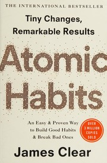
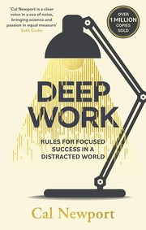
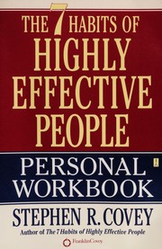
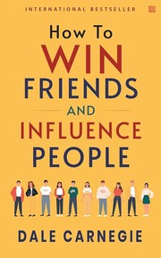
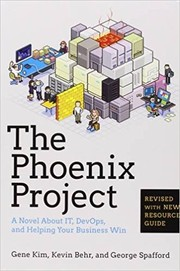
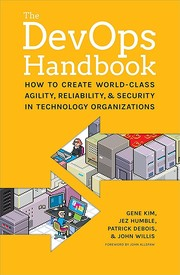
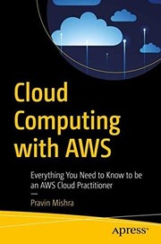
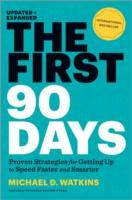
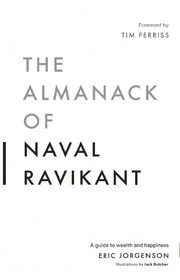

# Week 01 — Success Mindset (Mindset OS)

Part of the DevOps Micro Internship (DMI) with Agentic AI

---

## Task 1 — A Belief You Hold

### Question

What is something you believe to be true that most people around you would disagree with?

Write at least **50 words**. Be honest, specific, and use clear professional sentences.

### Your Answer

One belief I hold that many people around me disagree with is this: I don't believe in destiny. I believe our lives are shaped far more by the choices we make than by a future that has already been written. Every decision we make opens one door and closes another. While we can't control every circumstance, we can control how we respond to them. To me, the future isn't something we discover, it's something we create through consistent actions, personal responsibility, and the courage to choose differently.

---

## Task 2 — Three Objective Truths Discovered Through Experimentation

Write three objective truths you discovered through your own actions and results. For each truth, include one sentence for the truth and two to four lines of evidence from your life.

### Truth #1

**Truth**

Action creates opportunities

**Evidence from My Life**

Add your answer here...

### Truth #2

**Truth**

Add your answer here...

**Evidence from My Life**

Add your answer here...

### Truth #3

**Truth**

Add your answer here...

**Evidence from My Life**

i have waited for the "right time" all my life which rarely changed nothing. Most of the opportunities I've received came after I started taking action, sharing my work, and putting myself out there on linkedin

---

## Task 3 — What Does Your 2.0 Version Look Like?

Write and publicly publish an article about your future professional self, written as if a journalist is writing about you **3–7 years from now**.

Your article must:

* Be at least **300 words**.
* Be written in the **past tense**, as if it has already happened.
* Include specific proof such as projects, portfolio, GitHub, blogs, certifications, job role, leadership, or community contribution.
* Be published on LinkedIn, Medium, WordPress, Blogspot, a personal blog, or a portfolio page.

### My Article

Paste your complete article here...

### Public Article URL

```text
Paste your published article URL here...
```

### LinkedIn Post URL

Create a LinkedIn post sharing your published article, then add the URL below.

```text
Paste your LinkedIn post URL here...
```

### Credit Note — DMI Self-Paced Engineer Track Students

Add this credit note at the end of your public article. Replace `YOUR-GITHUB-USERNAME` with your actual GitHub username.

> **P.S. This post is part of the DevOps Micro Internship (DMI) — Self-Paced Engineer Track — by [Pravin Mishra](https://www.linkedin.com/in/pravin-mishra-aws-trainer/). My graded progress is public:** https://dmi.pravinmishra.com/s/YOUR-GITHUB-USERNAME.html **· Start your DevOps journey:** https://dmi.pravinmishra.com/?utm_source=student&utm_medium=ps-blog&utm_campaign=self-paced

`#DMIByPravinMishra`

Tag [Pravin Mishra](https://www.linkedin.com/in/pravin-mishra-aws-trainer/) in your LinkedIn post.

### Credit Note — DMI Campus Students

Add this credit note at the end of your public article. Replace `YOUR-GITHUB-USERNAME` with your actual GitHub username.

> **P.S. This post is part of the DevOps Micro Internship (DMI) — Campus — by [Pravin Mishra](https://www.linkedin.com/in/pravin-mishra-aws-trainer/). My graded progress is public:** https://dmi.pravinmishra.com/s/YOUR-GITHUB-USERNAME.html **· Start your DevOps journey:** https://dmi.pravinmishra.com/?utm_source=student&utm_medium=ps-blog&utm_campaign=campus

`#DMIByPravinMishra`

Tag [Pravin Mishra](https://www.linkedin.com/in/pravin-mishra-aws-trainer/) and Lead Co-Mentor [Anjana Muthunayake](https://www.linkedin.com/in/anjana-muthunayake/) in your LinkedIn post.

---

## Task 4 — Reflection on Cutting Corners

### Question

Have you ever cut corners through unethical, dishonest, or shortcut behaviour (not necessarily illegal)? If yes, how did it make you feel?

You do not need to tell the full story. Focus on the emotions you experienced. If your answer is yes, write **50–100 words**.

### Your Answer

**Yes / No:**

Every decision has a cost

**Reflection:**

My dad always says "whether you choose to act or choose to wait, you're still making a decision. Every choice leads to a different outcome, and accepting responsibility for those choices is what ultimately shapes your future" that has lived with me

---

## Task 5 — Your One-Year Non-Fiction Reading Plan

List **10 non-fiction books** you plan to read during the next year. Include the title and author of each book. Books in any language are allowed.

<<<<<<< HEAD
Consistency beats talent

### Evidence from my life

I've seen that showing up every day, even imperfectly, produces better results than relying on natural ability alone. The people who keep improving eventually outperform those who only depend on talent.
=======
1. Add book title and author here...
2. Add book title and author here...
3. Add book title and author here...
4. Add book title and author here...
5. Add book title and author here...
6. Add book title and author here...
7. Add book title and author here...
8. Add book title and author here...
9. Add book title and author here...
10. Add book title and author here...
>>>>>>> upstream/main

---

## Task 6 — Your Life and Career Metrics

List the things you will measure regularly in your life and career. You only need to list the metric topics; do not include personal numbers.

Your list must include learning or skills, output or proof, health or energy, time or focus, and money or finance.

<<<<<<< HEAD
**Minimum 300 words.**

### Rules

* Write in past tense, like it already happened.
* Don't use "likes to / wants to / hopes to."
* Use specifics:

  * built
  * shipped
  * led
  * published
  * earned
  * relocated
  * contributed
* Include skills proof:

  * projects
  * portfolios
  * GitHub
  * blogs
  * certifications
  * job role
  * leadership
  * community contribution
* Add 1–3 images if you can (optional but powerful).

### Publish It Publicly On Any ONE

* LinkedIn
* Medium
* WordPress
* Blogspot
* Personal blog
* Portfolio page

Use the credit note that matches your track:

Add the following credit note at the end of your post **(If you are DMI Cohort 3 student)**:

> **P.S. This post is part of the DevOps Micro Internship (DMI) with Agentic AI — Cohort 3 — by [Pravin Mishra](https://www.linkedin.com/in/pravin-mishra-aws-trainer/). My graded progress is public: https://dmi.pravinmishra.com/s/YOUR-GITHUB-USERNAME.html · Start your DevOps journey: https://dmi.pravinmishra.com/?utm_source=student&utm_medium=ps-blog&utm_campaign=cohort3**

Add the following credit note at the end of your post **(If you are DMI Self-paced track student)**:

> **P.S. This post is part of the DevOps Micro Internship (DMI) — Self-Paced Engineer Track — by [Pravin Mishra](https://www.linkedin.com/in/pravin-mishra-aws-trainer/). My graded progress is public: https://dmi.pravinmishra.com/s/YOUR-GITHUB-USERNAME.html · Start your DevOps journey: https://dmi.pravinmishra.com/?utm_source=student&utm_medium=ps-blog&utm_campaign=self-paced**

Add the following credit note at the end of your post **(If you are DMI Campus student)**:

> **P.S. This post is part of the DevOps Micro Internship (DMI) — Campus — by [Pravin Mishra](https://www.linkedin.com/in/pravin-mishra-aws-trainer/). My graded progress is public: https://dmi.pravinmishra.com/s/YOUR-GITHUB-USERNAME.html · Start your DevOps journey: https://dmi.pravinmishra.com/?utm_source=student&utm_medium=ps-blog&utm_campaign=campus**

## Your Article

If everything I've been working toward becomes reality, my 2.0 version won't just have a better job title or more certifications.

He'll have something far more valuable.

Trust.

He'll be the person founders think about before launching their product, not after it crashes.

The engineer companies bring into conversations early because they understand that building technology is one challenge, but building it to scale, stay secure, and survive real users is another.

He won't simply automate deployments.

He'll build confidence.

Confidence that every deployment is repeatable.

Confidence that every cloud environment is secure.

Confidence that businesses can grow without worrying whether their infrastructure will fail under pressure.

By then, DevOps won't just be a career.

It will be the language through which he solves business problems.

His LinkedIn won't just be a portfolio of certificates.

It will be a library of lessons.

A place where students discover opportunities, founders gain clarity, and engineers learn from real-world experiences instead of textbook definitions.

He'll still explain technical concepts the same way he does today—with stories, analogies, and simple words—because he'll remember what it felt like to be a beginner.

People won't follow him because of algorithms.

They'll follow him because they leave every conversation understanding something they didn't understand before.

His GitHub will showcase solutions instead of experiments.

His cloud projects will support real businesses.

His automation pipelines will save teams hours of manual work.

His security practices will prevent problems most people never even notice.

More importantly, he'll become known for something that can't be listed on a résumé:

Making complex things feel simple.

Helping people make better technical decisions.

Building systems that quietly do their job while businesses focus on theirs.

Looking back, he'll realize there was never a single moment that changed everything.

No destiny.

No lucky break.

Just thousands of small decisions repeated consistently over time.

And that will be the greatest proof of the belief he's always held:

The future isn't something we wait for.

It's something we build—one decision, one project, one lesson, and one person helped at a time.

### Public Link

Paste your link here:

`Add your URL here`

---

# Assignment 4. Have you ever cut corners (unethical / dishonest / shortcut behavior — not necessarily illegal)? If yes, how did it make you feel?

### Important

You don't need to write the full story.

Focus on the feeling:

* guilt
* fear
* shame
* stress
* regret
* numbness
* etc.

This is about self-awareness, not judgment.

### Answer Format

**Yes / No**

If Yes:

**What emotion did you feel?** (minimum 50–100 words)

## Answer

I haven't cut corners

---

# Assignment 5. What are 10 non-fiction books you plan to read in the next 1 year?

### Rules

* Mention **Title + Author**
* Any language allowed
* No fiction novels

### Tip

Choose books that improve:

* mindset
* communication
* productivity
* health
* money
* career
* leadership

## Book List

1. Atomic Habits — James Clear



2. Deep Work — Cal Newport



3. The Psychology of Money — Morgan Housel


4. The 7 Habits of Highly Effective People — Stephen R. Covey



5. How to Win Friends and Influence People — Dale Carnegie



6. The Phoenix Project — Gene Kim, Kevin Behr & George Spafford



7. The DevOps Handbook — Gene Kim, Jez Humble, Patrick Debois & John Willis



8. Cloud Computing with AWS - Pravin Mishra



9. The First 90 Days — Michael D. Watkins



10. The Almanack of Naval Ravikant — Eric Jorgenson



---

# Assignment 6. What are the things you will measure regularly in your life and career?

### Rules

List topics only. No need to share numbers.

### Must Include

* Learning / skill
* Output / proof
* Health / energy
* Time / focus
* Money / finance (personal or business)

### Example

* Learning hours per week
* Deep work sessions per week
* Projects shipped / documented
* Steps / workouts
* Sleep hours
* Spending tracker

## My Metrics
=======
### My Metrics
>>>>>>> upstream/main

* Financial Growth
* Sleep hours
* Teaching & Mentorship Impact
* Personal Discipline
* Health & Fitness
* Projects Completed
* Time with family
* Network Growth
* Professional Certifications
* Content Consistency

---

## Task 7 — Brain Dump and Three-Month System Plan

### Step 1 — Brain Dump (Private)

Do a private brain dump in a notebook, notes app, or document. Include everything currently on your mind, such as tasks, bills, worries, goals, pending messages, ideas, and responsibilities.

**Did you create a brain dump?**

```text
Yes / No
```

<<<<<<< HEAD
### Did You Do It?

**Yes / No**

Answer: Yes

* Financial status
* Marriage
* Family responsibility
* Health issues
* Loan issues
* Inferiority complex
* Societal pressure

---

## Step 2: Your 5-Month Routine + Focus Blocks

Create a simple plan you can realistically follow for the next 5 months.

### Weekly Routine

Example:

* Mon–Thu: 60 min deep work
* Sat: DMI session
* Sun: Weekly review
=======
### Step 2 — My Three-Month Routine and Focus Blocks
>>>>>>> upstream/main

#### My Weekly Routine

* Mon- Reflection of weekend learning
* Tue - 8 hours intense reading
* Wed - Still 8 hours intense reading
* Thur - 8 hours intense reading
* Friday - Rest
* Sat - DMI session
* Sunday - REVISION

#### When Will I Complete My DMI Work? (Include Days and Time)

* DAYS - MON - THUR + SAT 
* TIME - 10:00AM - 5:00PM

#### How Many DMI Work Sessions Will I Complete Each Week?

4 SESSIONS

#### My Distraction Rules

<<<<<<< HEAD
No social media while reading
=======
* Add your answer here...
* Add your answer here...
* Add your answer here...
* Add your answer here...
>>>>>>> upstream/main

---

## Task 8 — Week 1 Reflection and Proof of Work

### Biggest Insight I Got About Myself This Week

I can be anything i put my mind to become

### My Biggest Weakness or Loop I Noticed

Doomscrolling on social media

### One System I Will Implement From This Week (Exact Habit and Time)

Waking up 4:00am to finish my morning chores and starting my intensive 8 hours study from 10:00am

### Proof of Work

**LinkedIn Post URL**

```text
Paste your LinkedIn post URL here...
```

**Blog / Medium / Public Article URL**

```text
Paste your published article URL here...
```

---

## Completion Checklist

* [ ] All eight tasks are completed.
* [ ] All written answers are honest, specific, and written in clear professional sentences.
* [ ] Task 1 has at least 50 words.
* [ ] Task 2 includes all three truths and evidence from my life.
* [ ] Task 3 includes a 300+ word article written in past tense.
* [ ] My Task 3 article is published on an approved public platform.
* [ ] I added the correct DMI credit note and replaced `YOUR-GITHUB-USERNAME`.
* [ ] I published a LinkedIn post sharing my Task 3 article.
* [ ] Task 5 has 10 non-fiction books with titles and authors.
* [ ] Task 6 includes learning, output, health, time, and finance metrics.
* [ ] I completed the private brain dump for Task 7.
* [ ] I added a realistic three-month routine, DMI focus blocks, and distraction rules.
* [ ] I completed the Week 1 reflection.
* [ ] I added both the LinkedIn post and public article URLs under Task 8.

---


## 📌 About DMI & CloudAdvisory

DevOps Micro Internship (DMI) is a project-based DevOps program run by Pravin Mishra (The CloudAdvisory) focused on real-world execution, systems thinking, and career readiness.

It helps learners build strong DevOps foundations with hands-on experience.


## 📌 Resources

- 🌐 **DMI Official Website:** https://dmi.pravinmishra.com?utm_source=github&utm_medium=readme  
- 🎓 **University:** https://university.pravinmishra.com?utm_source=github&utm_medium=readme  
- 💬 **Discord Community:** https://discord.pravinmishra.com?utm_source=github&utm_medium=readme  
- 📝 **Blog:** https://dmi.pravinmishra.com/blog?utm_source=github&utm_medium=readme  
- ▶️ **YouTube Playlist (DMI Cohort 3):** https://www.youtube.com/playlist?list=PLFeSNDtI4Cho  
- 🔗 **Pravin Mishra (LinkedIn):** https://www.linkedin.com/in/pravin-mishra-aws-trainer/  
- 🏢 **CloudAdvisory (LinkedIn):** https://www.linkedin.com/company/thecloudadvisory/

---

*This submission is part of DevOps Micro Internship (DMI) — Agentic AI Track*