# Assignment — Deploy EpicBook with Terraform and Ansible Roles

Part of the DevOps Micro Internship (DMI) with Agentic AI

---

## Purpose

In this assignment, you will deploy the EpicBook web application using Terraform and Ansible roles.

Terraform provisions the cloud infrastructure, including one Ubuntu VM and one managed MySQL database. Ansible roles configure the VM, install required software, deploy the EpicBook application, configure Nginx, connect the app to the managed MySQL database, and verify the deployment.

---

# Task 1 — Set Up the Project Folder Layout

## Goal

Create the project folder structure for Terraform and Ansible roles.

Terraform will be used to provision the cloud infrastructure. Ansible roles will be used to configure the VM and deploy the EpicBook application.

### Evidence

#### Screenshot 1 — Terminal showing the completed `epicbook-prod` project structure

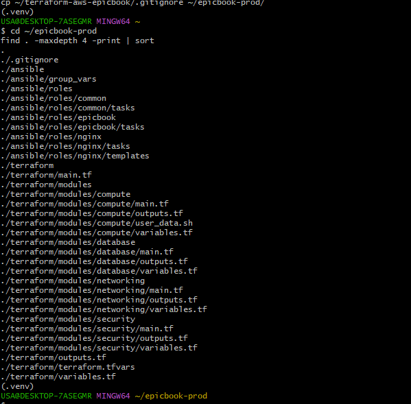

---

### Notes

Answer the following in your own words:

**1. Which cloud provider did you choose for this assignment?**

I chose Amazon Web Services (AWS) to host the EpicBook application and its managed MySQL database.

---

**2. Why is it useful to keep Terraform files and Ansible files in separate folders?**

Keeping them separate makes the project easier to organize and maintain. Terraform files define and provision the infrastructure, while Ansible files configure the server and deploy the application. This separation also makes troubleshooting and future updates easier.

---

**3. What is the purpose of the `roles` directory in Ansible?**

The roles directory organizes configuration tasks into reusable components. In my project, the roles separate common server setup, Nginx configuration, and EpicBook application deployment.

---

# Task 2 — Provision the Infrastructure with Terraform

## Goal

Run Terraform to provision the cloud infrastructure for the EpicBook deployment.

Terraform will create the VM, managed MySQL database, networking, security rules, and required outputs.

### Evidence

#### Screenshot 2 — `terraform apply` completed successfully

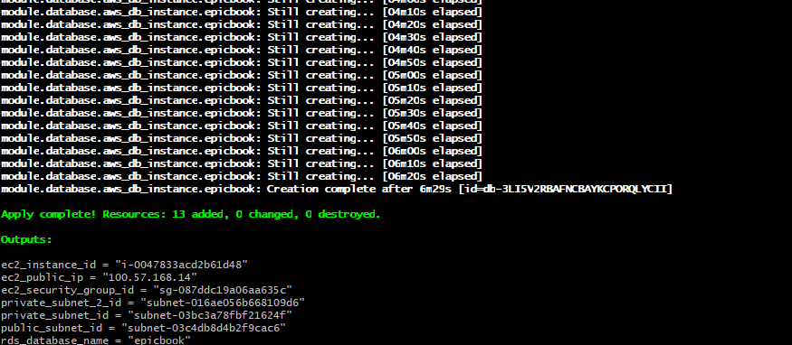

---

#### Screenshot 3 — Output of `terraform output`

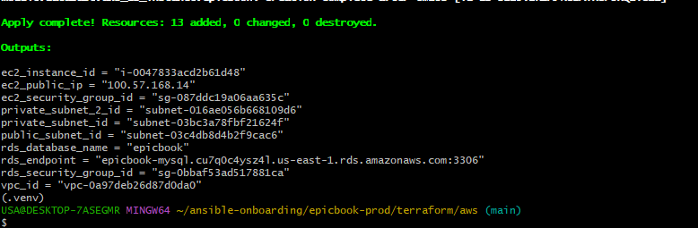

---

#### Screenshot 4 — Azure Portal or AWS Console showing the VM running

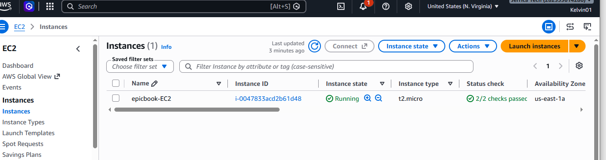

---

#### Screenshot 5 — Azure Portal or AWS Console showing the managed MySQL database created

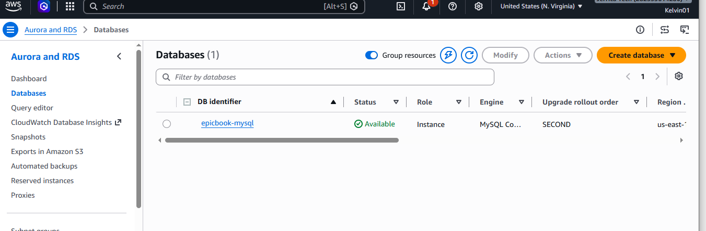

---

### Notes

Answer the following in your own words:

**1. What resources did Terraform create for this assignment?**

Terraform provisioned the AWS infrastructure for the deployment, including an Ubuntu EC2 instance, a managed MySQL database using Amazon RDS, networking components, security rules, and outputs needed to access the resources.

---

**2. Why should you review `terraform plan` before running `terraform apply`?**

I review terraform plan to understand which resources Terraform intends to create, modify, or destroy before making changes. This helps identify mistakes, unexpected changes, and potential security or cost issues.

---

**3. Why should database passwords not be shown in Terraform output?**

Database passwords are sensitive credentials. Exposing them in terminal output, screenshots, logs, or shared files can allow unauthorized people to access the database. Sensitive values should be protected and managed through an appropriate secrets-management method.

---

# Task 3 — Verify SSH Key-Based Access

## Goal

Verify that the cloud VM can be accessed from the Ansible controller using SSH key-based authentication.

### Evidence

#### Screenshot 6 — Successful SSH hostname check from the Ansible controller

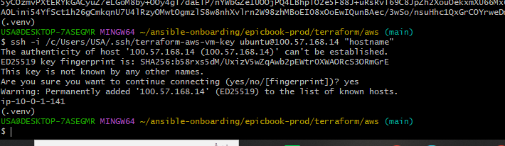

---

### Notes

Answer the following in your own words:

**1. What command did you use to verify SSH access?**

ssh -i /path/to/private-key ubuntu@<public_ip> hostname

---

**2. What proves that SSH key-based access worked successfully?**

Successful execution of the command and the return of the EC2 instance's hostname without a password prompt or an authentication error prove that SSH key-based access worked.

---

**3. What would you check if SSH returned `Permission denied (publickey)`?**

I would verify that I used the correct private key, the correct public IP address, and the correct username, usually ubuntu for an Ubuntu EC2 instance. I would also check the key's file permissions, confirm that the matching public key was configured for the instance, and verify that the security group allows SSH on port 22 from my IP address.

---

# Task 4 — Create the Ansible Inventory and Configuration

## Goal

Create the Ansible inventory file and local Ansible configuration for the EpicBook VM.

The inventory tells Ansible which VM to manage and which SSH user to use.

### Evidence

#### Screenshot 7 — `inventory.ini` showing the VM under the `web` group

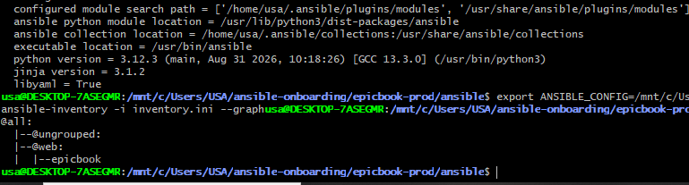

---

#### Screenshot 8 — Output of `ansible-inventory -i inventory.ini --graph`

---

#### Screenshot 9 — Output of `ansible web -i inventory.ini -m ping`

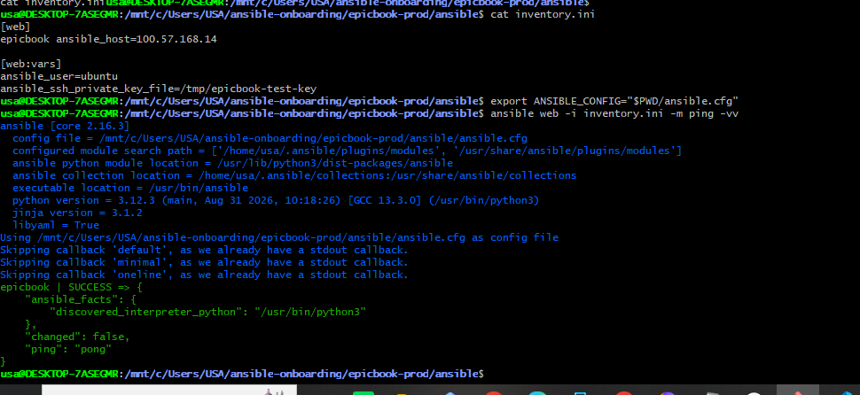

---

### Notes

Answer the following in your own words:

**1. What is the purpose of `inventory.ini`?**

The inventory.ini file tells Ansible which servers to manage and groups related servers together. I used it to define the EpicBook EC2 instance under the web group.

---

**2. What does `ansible_host` store?**

ansible_host stores the IP address or hostname that Ansible uses to connect to a managed host. In my deployment, it stores the EC2 instance's public IP address.

---

**3. What does `ansible_ssh_private_key_file` tell Ansible?**

It specifies the private key file Ansible should use to authenticate with the remote server over SSH.

---

**4. Why is `host_key_checking = False` used only for this temporary lab?**

Disabling host-key checking can simplify connections when instances are frequently created and replaced in a temporary lab. However, it weakens protection against server impersonation. In production, I would keep host-key verification enabled and manage trusted host keys properly.

---

# Task 5 — Create the Main Ansible Playbook

## Goal

Create the main Ansible playbook that runs the required roles in the correct order.

The `site.yml` file will call the `common`, `nginx`, and `epicbook` roles.

### Evidence

#### Screenshot 10 — `site.yml` showing the roles in the correct order

---

#### Screenshot 11 — Output of `ansible-playbook -i inventory.ini site.yml --syntax-check`

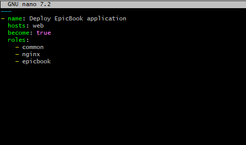

---

### Notes

Answer the following in your own words:

**1. What is the purpose of `site.yml`?**

The site.yml file is the main Ansible playbook. It defines the target hosts, privilege escalation, and the roles that Ansible runs to configure the server and deploy EpicBook.

---

**2. Why should the roles run in the order `common`, `nginx`, and `epicbook`?**

The common role prepares the server and installs shared dependencies. The nginx role installs and configures the web server. The epicbook role then deploys and starts the application. This order helps ensure that the server is prepared before the application is deployed.

---

**3. What does `become: true` allow Ansible to do?**

become: true allows Ansible to use privilege escalation, usually through sudo, to perform administrative tasks such as installing packages, managing services, and writing protected configuration files.

---

# Task 6 — Create the `common` Role

## Goal

Create the `common` role to prepare the Ubuntu VM with the basic packages required for the EpicBook deployment.

This role handles the common server setup before Nginx and the application are configured.

### Evidence

#### Screenshot 12 — `roles/common/tasks/main.yml` showing the common setup tasks

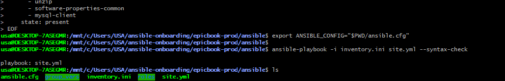

---

### Notes

Answer the following in your own words:

**1. What is the responsibility of the `common` role?**

The common role prepares the Ubuntu EC2 instance for deployment. It installs and configures basic packages and dependencies needed by the other roles and the application.

---

**2. Why should Nginx installation not be placed inside the `common` role?**

Nginx has a specific responsibility in the deployment, so it is better managed by its own role. Separating it keeps the common role focused on general server preparation and makes the configuration easier to reuse and maintain

---

**3. Why is `mysql-client` useful in this deployment?**

The MySQL client provides command-line tools for connecting to and troubleshooting the managed MySQL database. It can help verify database connectivity and diagnose connection problems without installing a full MySQL database server on the EC2 instance.

---

# Task 7 — Create the `nginx` Role

## Goal

Create the `nginx` role to install Nginx and configure it as a reverse proxy for the EpicBook application.

Nginx will receive browser traffic on port `80` and forward it to the EpicBook Node.js application running on the VM.

### Evidence

#### Screenshot 13 — `roles/nginx/tasks/main.yml` showing Nginx installation and site configuration tasks

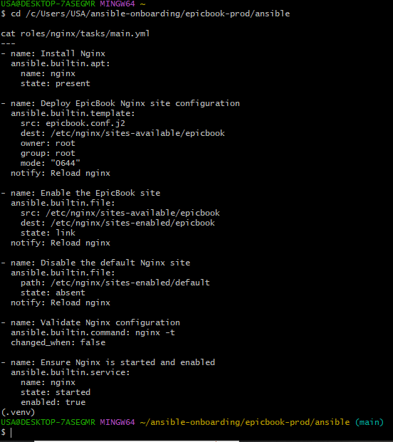

---

#### Screenshot 14 — `roles/nginx/templates/epicbook.conf.j2` showing the reverse proxy configuration

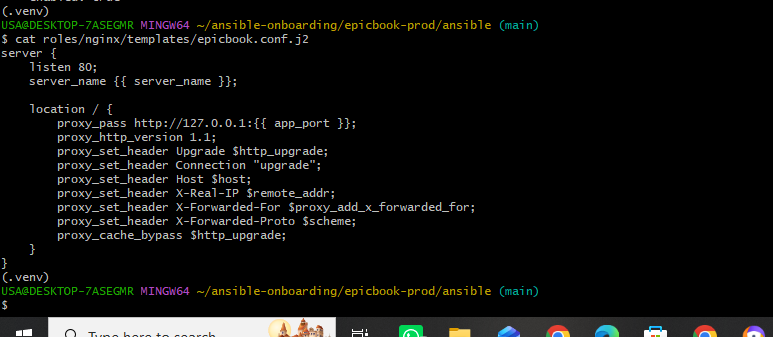

---

### Notes

Answer the following in your own words:

**1. What is the responsibility of the `nginx` role?**

The nginx role installs Nginx, deploys the EpicBook site configuration, enables the site, disables the default site, validates the configuration, and ensures the Nginx service is running and enabled at startup.

---

**2. Why is Nginx configured as a reverse proxy in this deployment?**

Nginx accepts incoming HTTP requests on port 80 and forwards them to the EpicBook Node.js application on port 8080. This provides a public entry point for the application and separates web traffic handling from the application process.

---

**3. Why should the application port come from `group_vars/web.yml` instead of being hard-coded?**

Using a variable makes the application port easier to change and reuse across configuration files and roles. If the port changes, I can update the variable rather than manually editing multiple files. In my project, the group variables were organized under group_vars/web/vars.yml.

---

# Task 8 — Create the `epicbook` Role

## Goal

Create the `epicbook` role to deploy the EpicBook application, connect it to the managed MySQL database, and run the application on port `8080` using PM2.

### Evidence

#### Screenshot 15 — `roles/epicbook/tasks/main.yml` showing application deployment tasks

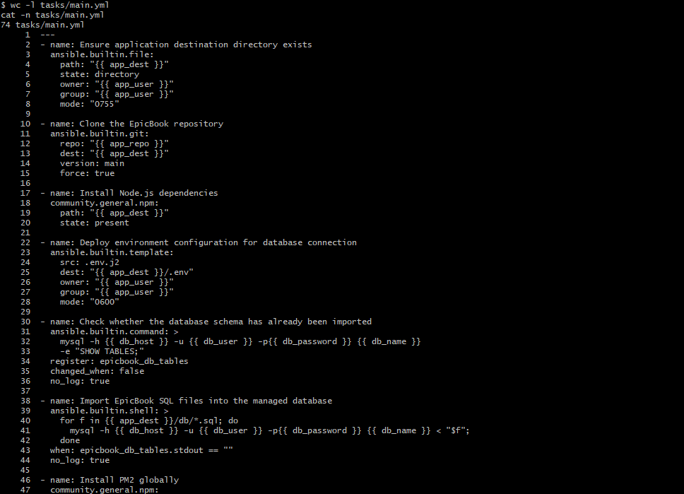

---

#### Screenshot 16 — Task or file showing how the database connection is configured, with secrets hidden

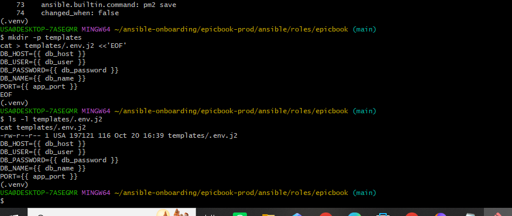

---

#### Screenshot 17 — Task or output showing the EpicBook application managed by PM2

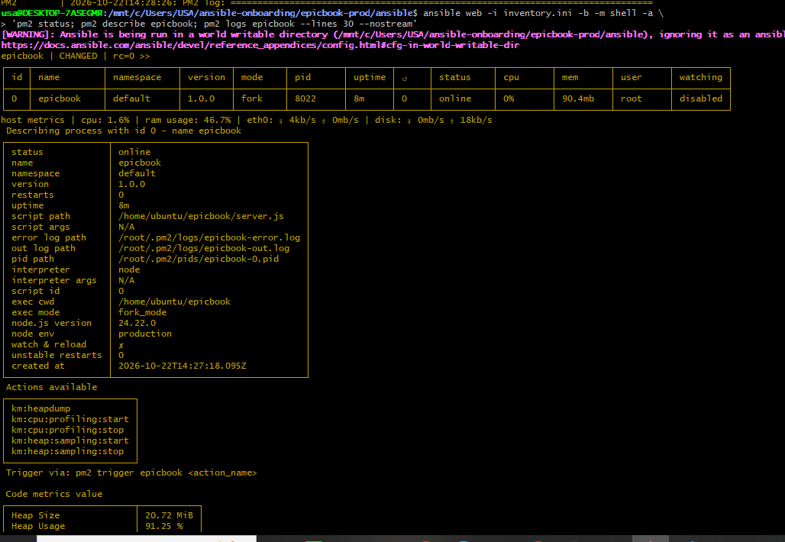

---

### Notes

Answer the following in your own words:

**1. What is the responsibility of the `epicbook` role?**

The epicbook role deploys the EpicBook source code, prepares the application directory, installs the required Node.js dependencies, configures database connection settings, and starts or manages the application using PM2.

---

**2. Why is PM2 used for the EpicBook Node.js application?**

PM2 is a process manager for Node.js applications. It keeps the application process running, allows it to be restarted if it crashes, provides process-status and log information, and supports managing the application in a more reliable way than running it manually in a terminal.

---

**3. Why should database passwords not be hard-coded in public files?**

Publicly stored passwords can be copied or discovered by unauthorized people, giving them access to the database. Passwords should be stored in a secrets manager or protected Ansible Vault file, excluded from version control where appropriate, and kept out of logs and screenshots.

---

**4. What does it mean for the application to run on port `8080` while Nginx listens on port `80`?**

The Node.js application listens internally on port 8080, while Nginx receives external HTTP requests on port 80 and forwards them to port 8080. Users access the website through Nginx without needing to specify the application's internal port.

---

# Task 9 — Create Group Variables

## Goal

Create reusable variables for the EpicBook deployment.

The `group_vars/web.yml` file stores values that can be reused across the Ansible roles.

### Evidence

#### Screenshot 18 — `group_vars/web.yml` showing the application, PM2, and database variables, with passwords hidden or masked

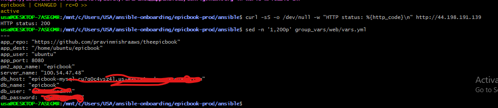

---

### Notes

Answer the following in your own words:

**1. What is the purpose of `group_vars/web.yml`?**

The group variables file stores shared configuration values for hosts in the web inventory group. This avoids repeating the same settings across multiple playbooks and roles. In my project, these values were stored in group_vars/web/vars.yml.

---

**2. Which values did you store in `group_vars/web.yml`?**

I stored the application repository URL, application destination directory, application user, application port, PM2 process name, Nginx server name, and managed MySQL connection settings, including the database host, database name, database username, and password variable.

---

**3. How did you handle the database password securely?**

The project used a database password variable in the Ansible group variables. However, the password was present in plaintext during the lab and was exposed in terminal output. Therefore, I would not describe the original handling as fully secure. Before production, I would rotate the exposed password and move the replacement into Ansible Vault or a managed secrets service, ensuring that it is not displayed in screenshots or committed to Git.

---

# Task 10 — Run the Ansible Playbook

## Goal

Run the Ansible playbook to configure the VM and deploy the EpicBook application.

The playbook should run the roles in this order:

1. `common`
2. `nginx`
3. `epicbook`

### Evidence

#### Screenshot 19 — Ansible playbook output showing the roles running

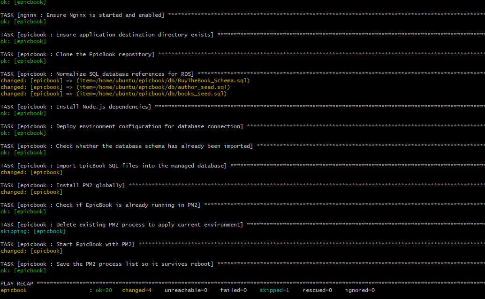

---

#### Screenshot 20 — Final Ansible recap showing `failed=0`

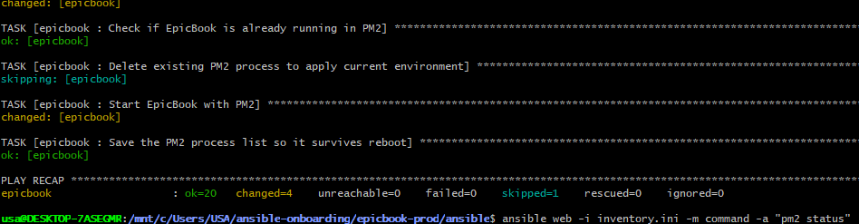

---

#### Screenshot 21 — Output of `ansible web -i inventory.ini -m command -a "systemctl is-active nginx" --become`

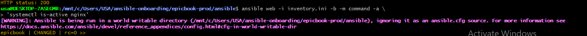

---

#### Screenshot 22 — Output of `ansible web -i inventory.ini -m command -a "pm2 status"`

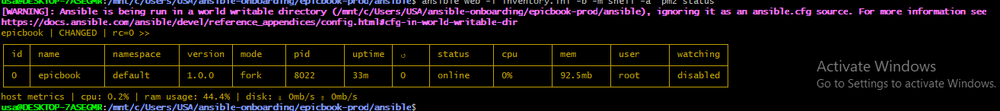

---

#### Screenshot 23 — Output of `ansible web -i inventory.ini -m command -a "curl -I http://localhost:8080"`

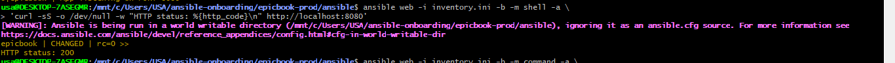

---

### Notes

Answer the following in your own words:

**1. What command did you run to execute the Ansible playbook?**

ansible-playbook -i inventory.ini site.yml

---

**2. How do you know all roles completed successfully?**

I checked the playbook output and the final PLAY RECAP. A recap showing failed=0 indicates that no tasks failed during that playbook run. I also verified the application and services separately.

---

**3. What proves that Nginx is active?**

ansible web -i inventory.ini -b -m command -a "systemctl is-active nginx"

---

**4. What proves that PM2 is managing the EpicBook application?**

The PM2 status output showed the epicbook process with an online status. This indicates that PM2 was managing the Node.js application process.

---

**5. What proves that the EpicBook application responds on port `8080`?**

The HTTP check against http://localhost:8080 returned status 200 OK. This showed that the application was responding to HTTP requests on port 8080.

---

# Task 11 — Verify the EpicBook Deployment

## Goal

Verify that the EpicBook application is running, accessible in the browser, and connected to the managed MySQL database.

### Evidence

#### Screenshot 24 — Output of `curl -I http://<public_ip>`

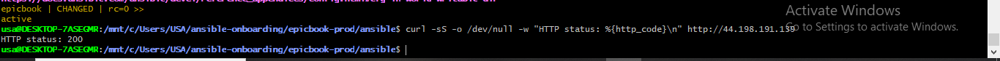

---

#### Screenshot 25 — Output of the cart API test command

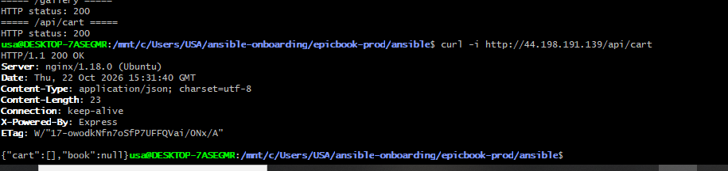

---

#### Screenshot 26 — Output of the `/cart` HTTP status check

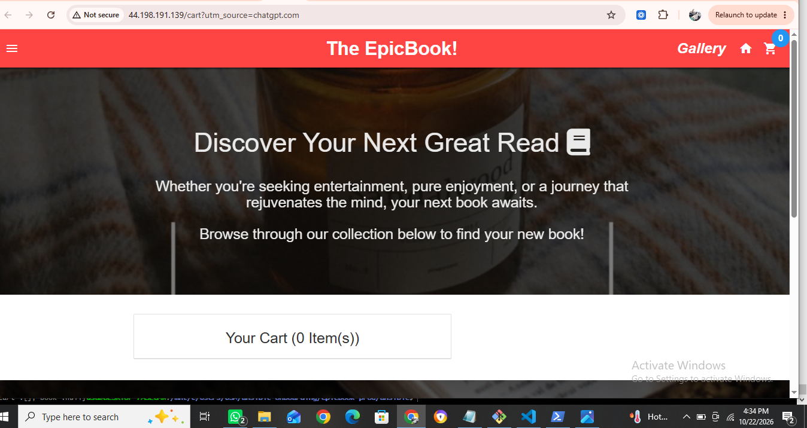

---

#### Screenshot 27 — Browser showing the EpicBook application loaded from `http://<public_ip>`

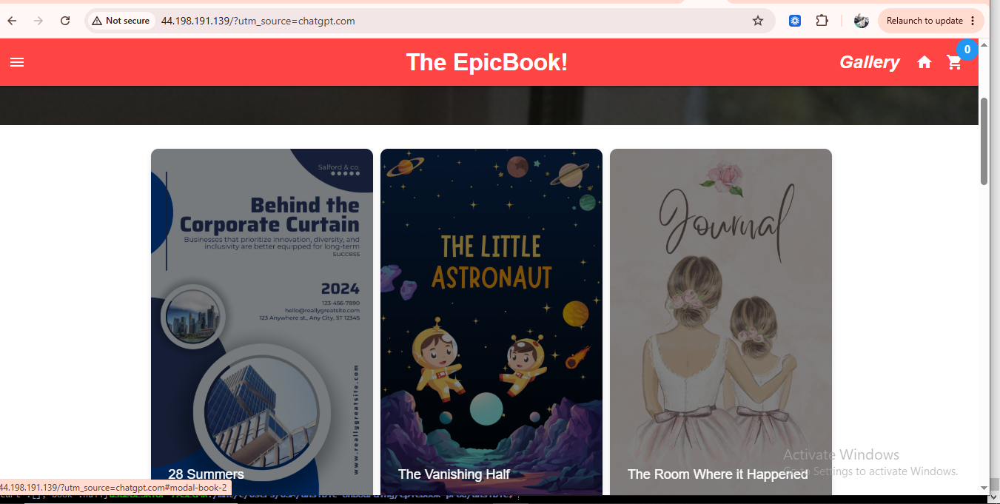

---

### Notes

Answer the following in your own words:

**1. What HTTP response did you receive from the public application URL?**

The public application URL returned HTTP status 200 OK, confirming that the homepage was accessible through the EC2 instance's public IP address.

---

**2. What did the cart API test prove?**

The cart API test returned HTTP 200 OK with a JSON response. This showed that the cart API endpoint was reachable through the public application URL and returned a valid response. The response showed an empty cart at the time of testing.

---

**3. What did the `/cart` status check return?**

After reloading Nginx, the public /cart endpoint returned HTTP status 200, confirming that the cart page route was accessible

---

**4. What issue did you face during verification, and how did you fix it?**

During verification, the homepage returned HTTP 200, but the public /cart, /gallery, and /api/cart endpoints initially returned HTTP 404 from Nginx. Direct requests to the Node.js application on port 8080 worked, indicating that the application routes existed. I tested the active Nginx configuration and reloaded Nginx after validating the configuration with nginx -t. After the reload, all four public endpoints returned HTTP 200.

---

# LinkedIn Post Required

## Evidence

#### LinkedIn Post URL

---

#### Screenshot — Published LinkedIn post

---

# Assignment Questions

Answer the following in your own words:

**1. Why is Terraform used for infrastructure provisioning?**

Terraform is used to define and provision cloud infrastructure through code. It makes infrastructure deployment repeatable, consistent, and easier to manage. In my project, I used Terraform to provision the AWS resources required for EpicBook, including the EC2 instance, managed MySQL database, networking, and security rules.

---

**2. Why are Ansible roles useful for production-style deployments?**

Ansible roles divide configuration and deployment tasks into reusable, organized components. They make playbooks easier to understand, maintain, troubleshoot, and reuse. In my project, the common, nginx, and epicbook roles each handled a separate part of the deployment.

---

**3. What is the purpose of `group_vars/web.yml`?**

t stores configuration values shared by hosts in the web inventory group. This lets different roles use common settings, such as the application port, repository, PM2 process name, and database connection details, without duplicating values. My project used group_vars/web/vars.yml for these settings

---

**4. Why should database passwords not be committed to GitHub?**

GitHub repositories can be public or shared with other people. If a database password is committed, unauthorized users may discover it and access sensitive data. Even if the password is removed later, it may remain in Git history. Passwords should be stored securely using tools such as Ansible Vault or AWS Secrets Manager, and any exposed password should be rotated.

---

**5. What is the purpose of Nginx in this deployment?**

Nginx acts as a reverse proxy. It accepts HTTP requests on port 80 and forwards them to the EpicBook Node.js application on port 8080. It provides the public entry point for the application and helps separate incoming web traffic from application processing.

---

**6. Why should the managed MySQL database not be publicly accessible?**

A publicly accessible database has a larger attack surface and may be targeted by unauthorized users. Keeping the database private and allowing connections only from authorized application infrastructure reduces exposure. Security groups should restrict access to the required database port and trusted sources.

---

**7. Why is PM2 used for the EpicBook Node.js application?**

PM2 manages the Node.js process, monitors its status, provides logs, and can restart the application if it crashes. It makes it easier to keep the application running and manage its lifecycle on the EC2 instance.

---

**8. What does idempotency mean in Ansible?**

Idempotency means that running the same Ansible task repeatedly should leave the system in the desired state without making unnecessary changes each time. For example, if Nginx is already installed and configured correctly, a subsequent playbook run should not reinstall or unnecessarily modify it.

---

**9. What issue did you face during the deployment, and how did you fix it?**

I faced an issue where the EpicBook homepage was accessible, but the public cart, gallery, and cart API endpoints returned HTTP 404. I checked the application routes and confirmed that the Node.js app responded correctly on port 8080. I then validated the Nginx configuration with nginx -t and reloaded Nginx. After that, the homepage, cart page, gallery, and cart API all returned HTTP 200.

---

**10. What security improvement would you make before using this setup in production?**

I would rotate the database password that was exposed during the lab and store the replacement in AWS Secrets Manager or Ansible Vault. I would also keep the RDS database private, restrict security-group access to trusted sources, enable HTTPS using a valid TLS certificate, enforce SSH key and host-key security, and ensure that sensitive values are not committed to GitHub or exposed in logs and screenshots

---

# Required Files

Confirm that the following files are included in your GitHub repository or assignment folder:

- [ ] `README.md`
- [ ] Terraform files under either `terraform/azure/` or `terraform/aws/`
- [ ] `ansible/ansible.cfg`
- [ ] `ansible/inventory.ini`
- [ ] `ansible/site.yml`
- [ ] `ansible/group_vars/web.yml`
- [ ] `ansible/roles/common/tasks/main.yml`
- [ ] `ansible/roles/nginx/tasks/main.yml`
- [ ] `ansible/roles/nginx/templates/epicbook.conf.j2`
- [ ] `ansible/roles/epicbook/tasks/main.yml`

---

# Submission Instructions

- Add all required screenshots in your submission.
- Full Name must be visible in required screenshots.
- Mention the cloud provider used: Azure or AWS.
- Add the VM public IP address.
- Add the final application URL.
- Add Terraform output proof.
- Add Ansible role tree proof.
- Add all required notes and assignment question answers.
- Add your LinkedIn post URL.
- Do not expose SSH private keys, passwords, cloud credentials, database credentials, Terraform state files, subscription IDs, or account IDs.

---

# Completion Checklist

- [ ] Task 1: Project folder layout created
- [ ] Task 2: Terraform infrastructure provisioned
- [ ] Task 3: SSH key-based access verified
- [ ] Task 4: Ansible inventory and configuration created
- [ ] Task 5: Main Ansible playbook created
- [ ] Task 6: `common` role created
- [ ] Task 7: `nginx` role created
- [ ] Task 8: `epicbook` role created
- [ ] Task 9: Group variables created
- [ ] Task 10: Ansible playbook run completed
- [ ] Task 11: EpicBook deployment verified
- [ ] Terraform files created under only one cloud provider folder
- [ ] One Ubuntu VM was created
- [ ] One managed MySQL database was created
- [ ] SSH port `22` is restricted to the controller public IP
- [ ] HTTP port `80` is accessible
- [ ] MySQL port `3306` is not publicly open
- [ ] `ansible web -i inventory.ini -m ping` returns `SUCCESS`
- [ ] `site.yml` calls the roles in the correct order
- [ ] Database secrets are hidden or handled securely
- [ ] Nginx is active
- [ ] PM2 shows the EpicBook application running
- [ ] EpicBook responds on port `8080`
- [ ] Public URL loads in the browser
- [ ] Cart API verification works
- [ ] Playbook completes with `failed=0`
- [ ] Screenshots 1–27 are included
- [ ] Assignment questions are answered
- [ ] LinkedIn post published
- [ ] LinkedIn post URL added
- [ ] No sensitive information is exposed

---

## About DMI & CloudAdvisory

DevOps Micro Internship (DMI) is a project-based DevOps program run by Pravin Mishra and The CloudAdvisory, focused on real-world execution, systems thinking, and career readiness.

It helps learners build strong DevOps foundations with hands-on experience.

---

## Resources

- DMI Official Website: [https://dmi.pravinmishra.com?utm_source=github&utm_medium=readme](https://dmi.pravinmishra.com?utm_source=github&utm_medium=readme)
- University: [https://university.pravinmishra.com?utm_source=github&utm_medium=readme](https://university.pravinmishra.com?utm_source=github&utm_medium=readme)
- Discord Community: [https://discord.pravinmishra.com?utm_source=github&utm_medium=readme](https://discord.pravinmishra.com?utm_source=github&utm_medium=readme)
- Blog: [https://dmi.pravinmishra.com/blog?utm_source=github&utm_medium=readme](https://dmi.pravinmishra.com/blog?utm_source=github&utm_medium=readme)
- YouTube Playlist: [https://www.youtube.com/playlist?list=PLFeSNDtI4Cho](https://www.youtube.com/playlist?list=PLFeSNDtI4Cho)
- Pravin Mishra LinkedIn: [https://www.linkedin.com/in/pravin-mishra-aws-trainer/](https://www.linkedin.com/in/pravin-mishra-aws-trainer/)
- CloudAdvisory LinkedIn: [https://www.linkedin.com/company/thecloudadvisory/](https://www.linkedin.com/company/thecloudadvisory/)

---

*This submission is part of DevOps Micro Internship (DMI) — Agentic AI Track.*