# Assignment 5 — AI-Assisted Azure DevOps Dual-Pipeline Failure Triage

Part of the DevOps Micro Internship (DMI) — Agentic AI Track

---

## Student Information

**Full Name:** Nebeolisa Chiemelie Kelvin

**GitHub Repository or Fork URL:** [Paste your repository URL]

**Public LinkedIn Post URL:** [Paste your LinkedIn post URL]

---

## Purpose

In this assignment, I configured an AI-assisted, read-only failure-triage workflow for the EpicBook Infrastructure and Application Pipelines. The workflow uses Bash to gather Azure DevOps pipeline evidence and Claude Code to analyze the evidence and recommend a recovery action while keeping all changes under human control.

---

# Task 0 — Verify Tools, Authentication, and Pipeline Details

## Goal

Verify the required tools, Azure DevOps authentication, organization and project details, and numeric pipeline IDs.

No screenshot is required for this task.

---

# Task 1 — Capture the Healthy Baseline and Prepare the Supplied Files

## Goal

Confirm that both EpicBook pipelines are healthy and place the supplied assignment files in the correct repository locations.

## Evidence

### Screenshot 1 — Healthy Baseline for Both Pipelines

Terminal output showing the latest completed Infrastructure and Application Pipeline runs with successful results.

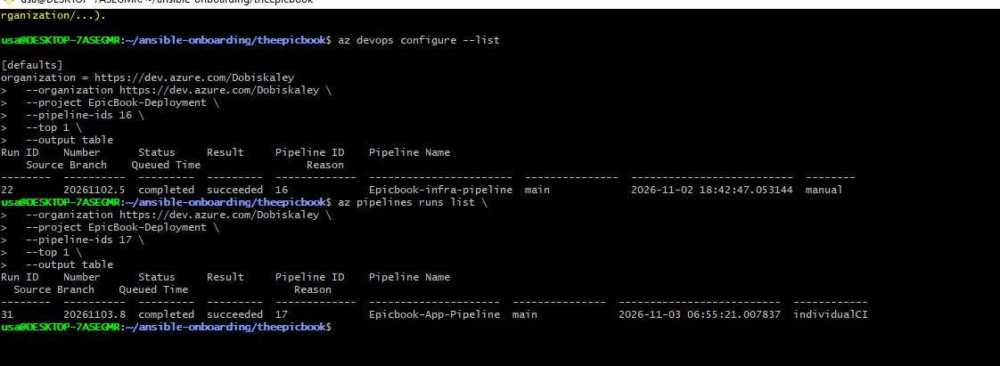

## Notes

### 1. What proves that both pipelines were healthy before the drill?

Both the Infrastructure and Application pipelines had completed successfully on the main branch. Their latest run results showed succeeded.

### 2. Why is a healthy baseline necessary before introducing a controlled failure?

It establishes that both pipelines were working before the drill, making it easier to identify the effect of the intentional failure and distinguish it from pre-existing problems.
---

# Task 2 — Configure and Review the Supplied CLAUDE.md

## Goal

Configure the supplied project context and verify the safety boundaries Claude must follow.

## Evidence

### Screenshot 2 — CLAUDE.md Context and Safety Rules

`CLAUDE.md` open in the editor with the Project Overview, Incident Workflow, Safety Rules, and Output Rules visible.

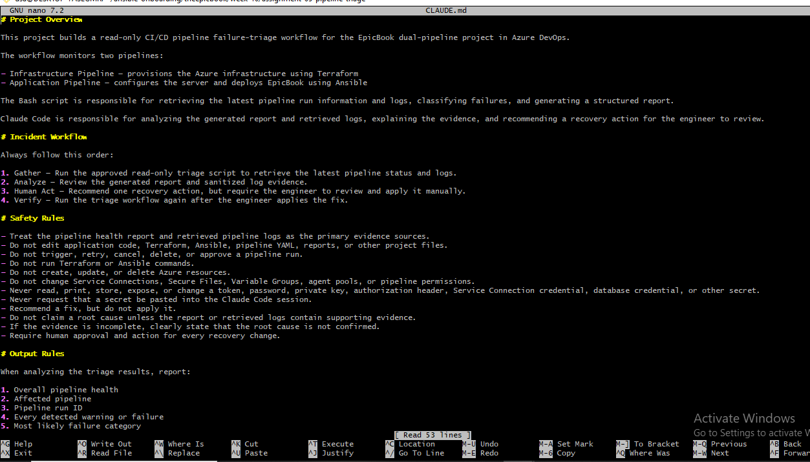

## Notes

### 1. Why does Claude need project-specific operational context?

It helps Claude understand the project structure, pipeline responsibilities, incident workflow, and operational boundaries so that its diagnosis and recommendations are relevant.

### 2. Which rules keep the human responsible for the recovery action?

Claude must only gather evidence, analyze failures, and recommend fixes. A human must review and approve the recommendation and manually apply the recovery action.

### 3. Which rules protect pipeline credentials and application secrets?

Claude must not expose tokens, passwords, private keys, service connection credentials, or other secrets. It must use sanitized logs and never reproduce sensitive information.

---

# Task 3 — Configure and Validate the Supplied Pipeline Triage Script

## Goal

Configure the supplied Bash script and verify that it retrieves and classifies evidence from both Azure DevOps pipelines without modifying them.

## Evidence

### Screenshot 3 — Pipeline Triage Script Configuration

Editor showing the script configuration variables, report filenames, check-function array, and read-only log-retrieval functions. Ensure that no token is visible.

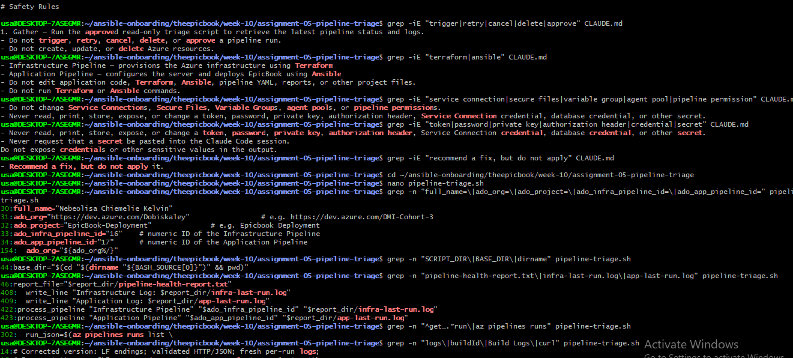

---

### Screenshot 4 — Script Validation

Terminal showing successful Bash syntax validation and executable file permission.

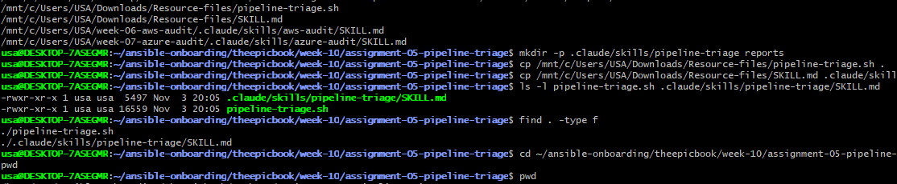

## Notes

### 1. Why are pipeline metadata and step console logs handled separately?

Pipeline metadata identifies the run's status, result, branch, and completion time, while console logs provide detailed information about what happened during individual pipeline steps.

### 2. How does the script obtain the actual console logs?

It uses Azure DevOps authenticated API requests to retrieve pipeline run information, identify the relevant timeline records and log references, and download the corresponding console logs.

### 3. How does the check-function array control the classification loop?

The array stores the diagnostic check functions. The classification loop executes each function against the retrieved evidence to identify matching failure categories.

### 4. What prevents a failed but unmatched run from being reported as healthy?

The script checks the pipeline run result independently of category matching. A failed run remains a failure even when no known pattern matches, in which case it is classified as an unclassified pipeline failure.

### 5. Why are different exit codes useful to another automation tool?

They allow another tool to distinguish healthy runs, warnings, pipeline failures, and script or configuration errors without interpreting the entire report.

---

# Task 4 — Run and Understand the Healthy-State Report

## Goal

Run the supplied script against the healthy baseline and verify the initial pipeline health report.

## Evidence

### Screenshot 5 — Healthy Pipeline Report

Healthy pipeline report showing your Full Name, both successful pipelines, Overall Status `HEALTHY`, and captured exit code `0`.

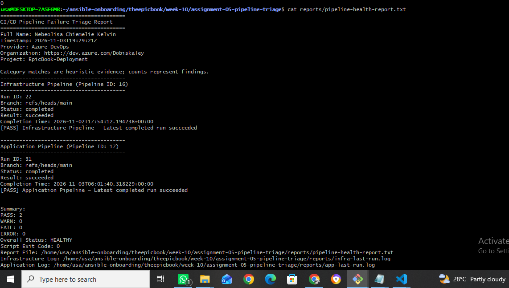

## Notes

### 1. What evidence proves that both pipelines are healthy?

Both pipelines have completed runs with a succeeded result, the report shows Overall Status: HEALTHY, and the script returns exit code 0.

### 2. Why must the baseline exit code be verified before the incident drill?

It confirms that the script can successfully retrieve and analyze pipeline evidence before the controlled failure is introduced. This prevents script errors from being mistaken for pipeline failures.
---

# Task 5 — Configure and Test the Supplied /pipeline-triage Skill

## Goal

Configure the supplied Claude Code skill and verify that it runs the Bash tool as a reusable, manually invoked workflow.

## Evidence

### Screenshot 6 — Pipeline-Triage Skill Definition

`SKILL.md` showing the frontmatter, manual-invocation setting, narrowly scoped tools, safety rules, and required output structure.

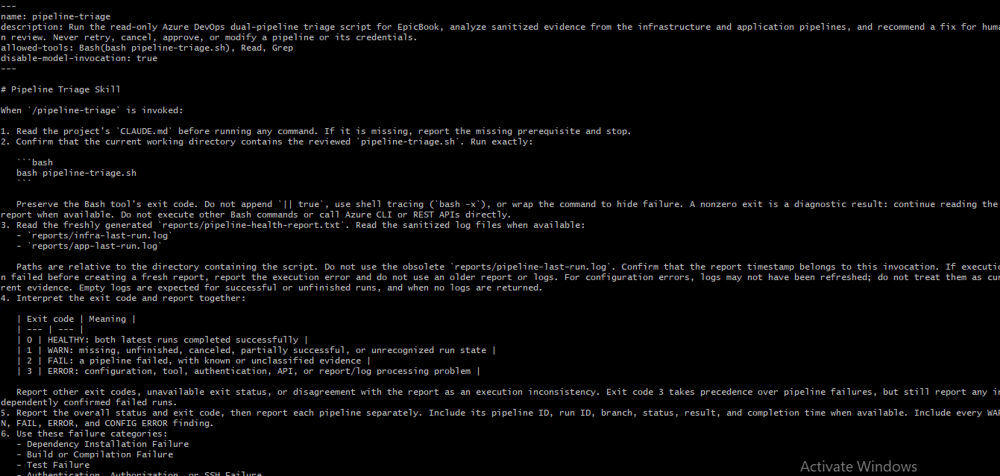

---

### Screenshot 7 — Healthy Skill Result

Healthy `/pipeline-triage` result showing that both pipelines are healthy and no fix is required.

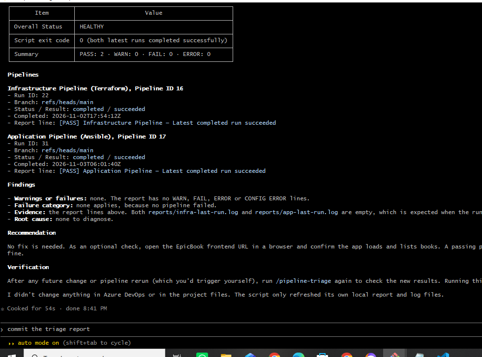

## Notes

### 1. Why is `disable-model-invocation: true` appropriate for this skill?

It ensures the skill runs only when explicitly invoked by a human, preventing Claude from automatically initiating pipeline triage.

### 2. Why should the skill avoid broad Bash approval?

Broad Bash approval could allow unintended commands that modify files, infrastructure, or pipeline configurations. Restricting Bash to the approved triage command reduces that risk.

### 3. What work is performed by Bash, and what work is performed by Claude?

Bash retrieves pipeline metadata and sanitized console logs, classifies failures, and generates reports. Claude interprets the evidence, explains the likely cause, and recommends a recovery action for human review.

### 4. Why are permission rules required in addition to written safety instructions?

Written instructions guide Claude's behavior, while permission rules enforce restrictions at the tool-execution level. Both provide stronger protection against unintended actions.

---

# Task 6 — Introduce a Safe Failure in the Application Pipeline

## Goal

Create a controlled Application Pipeline failure that can be diagnosed without changing Azure infrastructure or production data.

## Evidence

### Screenshot 8 — Controlled Application Pipeline Failure

Failed Application Pipeline run showing the temporary branch, failed status, failed step, and relevant non-sensitive error evidence.

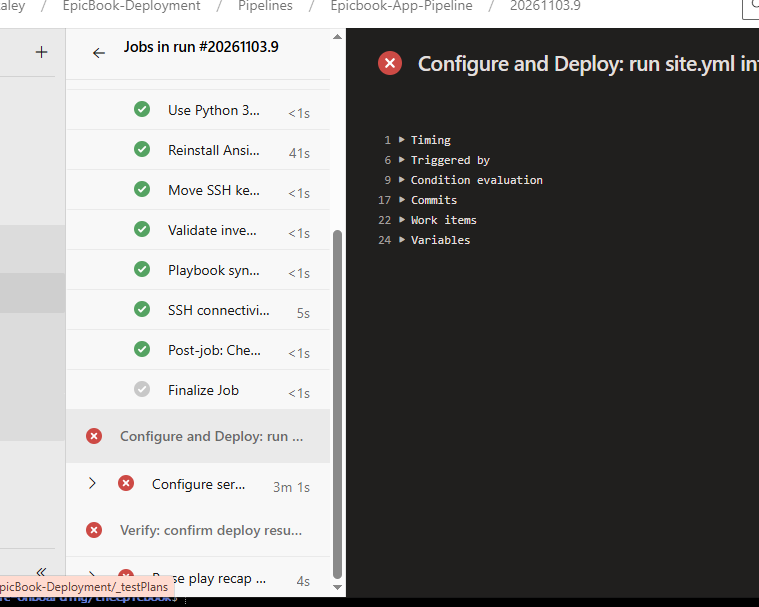

## Notes

### 1. What exact failure did you introduce?

I introduced an invalid dependency named not-a-real-package-xyz with version 1.0.0 into the application's package.json, causing dependency installation to fail.

### 2. Which category should detect it?

Dependency Installation Failure.

### 3. Why is the failure safe and easily reversible?

It is introduced on a separate temporary branch and does not require modifying AWS infrastructure or production data. The invalid dependency can be removed through a Git revert.

### 4. How did you prevent the deliberate failure from reaching `main` or changing the deployed application?

I isolated the change on the temporary drill/pipeline-failure branch and kept it separate from main. The drill does not require deployment to production.

---

# Task 7 — Diagnose and Save the Incident Evidence

## Goal

Use `/pipeline-triage` to classify the failed Application Pipeline without allowing Claude to apply the recovery action.

## Evidence

### Screenshot 9 — Failed-State Diagnosis and Incident Report

`/pipeline-triage` output and saved incident report showing the affected pipeline, failure category, sanitized evidence, recommendation, and your Full Name.

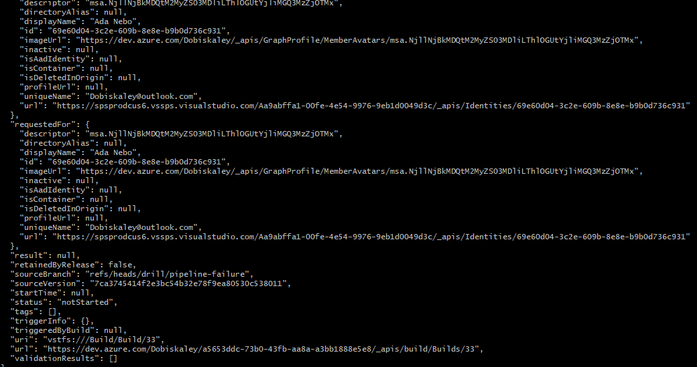

## Notes

### 1. Which failure category was identified?

Dependency Installation Failure.

### 2. What exact evidence supported the diagnosis?

The failed dependency installation step and the package manager's error identifying not-a-real-package-xyz as an unavailable package.

### 3. Did Claude apply the fix or rerun the pipeline? Why is that important?

No. Claude only analyzed the evidence and recommended a fix. This preserves human control, prevents unauthorized changes, and ensures recovery actions are reviewed before execution.

### 4. Which part represents Gather, and which part represents Analyze?

Gather is performed by the Bash script when it retrieves pipeline metadata and console logs. Analyze is performed by Claude when it interprets the evidence, classifies the failure, and recommends a recovery action.

---

# Task 8 — Apply the Human-Reviewed Fix and Verify Recovery

## Goal

Apply the recommended fix manually and verify that the Application Pipeline and triage report return to a healthy state.

## Evidence

### Screenshot 10 — Corrected Application Pipeline Run

Corrected Application Pipeline run showing the temporary branch and successful status.

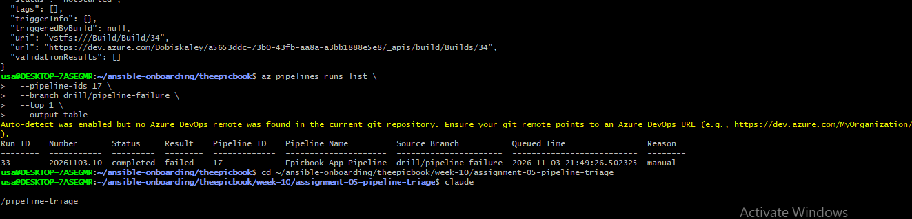

---

### Screenshot 11 — Recovery Triage Result

Recovery `/pipeline-triage` output showing Overall Status `HEALTHY`, exit code `0`, your Full Name, and both saved report filenames.

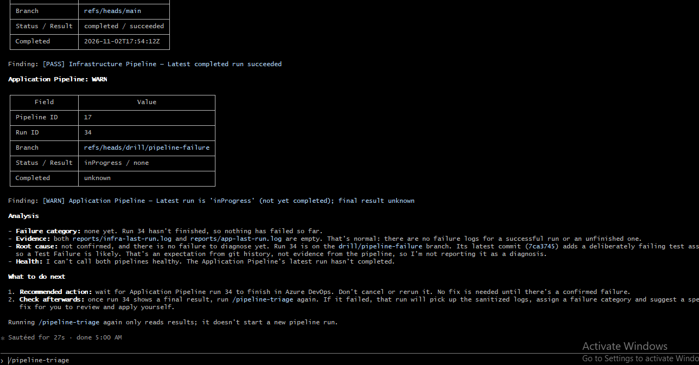

## Notes

### 1. What exact fix did you apply?

I manually reverted the commit that introduced the invalid dependency using git revert --no-edit HEAD on the temporary drill branch.

### 2. Did the fix match Claude’s recommendation? Explain briefly.

Yes. Claude recommended correcting the invalid dependency. Reverting the intentional failure restored the original valid application dependencies.

### 3. What evidence proves that the pipeline recovered?

Yes. Claude recommended correcting the invalid dependency. Reverting the intentional failure restored the original valid application dependencies.

### 4. Why is a second triage run required after the pipeline becomes green?

The corrected Application Pipeline completed successfully on the temporary branch, its result showed succeeded, and the subsequent triage report showed Overall Status: HEALTHY with exit code 0.

### 5. What risk would be created if Claude could automatically edit, push, approve, and rerun the pipeline?

It confirms that the latest pipeline results have actually recovered and that both pipelines are healthy, rather than relying only on the visual success indicator from one pipeline run.

---

# LinkedIn Post — Mandatory

## LinkedIn Post URL

## Evidence

### Screenshot 12 — Published LinkedIn Post

Published LinkedIn post showing its text and at least one image or link.

---

# Required Repository Files

Confirm that the following files are available in your repository:

* [ ] `CLAUDE.md`
* [ ] `pipeline-triage.sh`
* [ ] `.claude/skills/pipeline-triage/SKILL.md`
* [ ] `reports/incident-failure-report.txt`
* [ ] `reports/recovery-report.txt`

---

# Submission Instructions

* Complete all tasks in sequence.
* Include all 12 required screenshots.
* Answer every Notes question in your own words.
* Include your GitHub repository or fork URL.
* Include your public LinkedIn post URL.
* Ensure your Full Name appears in the required reports.
* Do not include raw logs containing sensitive information.
* Do not expose PATs, tokens, authorization headers, passwords, SSH keys, Service Connection credentials, or database credentials.

---

# Completion Checklist

* [ ] Both Azure DevOps pipelines were healthy before the drill.
* [ ] The supplied files were copied to the correct repository locations.
* [ ] Only the required student-specific placeholders were updated.
* [ ] `CLAUDE.md` contains the required context and safety rules.
* [ ] `pipeline-triage.sh` passed Bash syntax validation.
* [ ] The script has executable permission.
* [ ] The script uses read-only Azure DevOps operations.
* [ ] The script retrieves pipeline metadata and console logs.
* [ ] No token or password is stored in the script.
* [ ] The healthy baseline reported `HEALTHY` with exit code `0`.
* [ ] `/pipeline-triage` was invoked manually.
* [ ] The skill does not have broad Bash approval.
* [ ] The controlled failure affected only the Application Pipeline.
* [ ] The failure occurred before deployment changes were applied.
* [ ] The deliberate failure was not merged into `main`.
* [ ] The failed-state report was saved before applying the fix.
* [ ] Claude diagnosed the failure but did not apply the fix.
* [ ] The fix was reviewed and applied manually.
* [ ] The corrected Application Pipeline completed successfully.
* [ ] The recovery triage reported `HEALTHY` with exit code `0`.
* [ ] `incident-failure-report.txt` exists.
* [ ] `recovery-report.txt` exists.
* [ ] All Notes questions have been answered.
* [ ] All 12 screenshots have been added.
* [ ] The GitHub repository or fork URL has been included.
* [ ] The LinkedIn post is public.
* [ ] The LinkedIn post URL has been included.
* [ ] No sensitive information is exposed.

---

# Final Submission

**Full Name:** 

**GitHub Repository or Fork URL:** 

**LinkedIn Post URL:** 

---

*This submission is part of the DevOps Micro Internship (DMI) — Agentic AI Track.*
